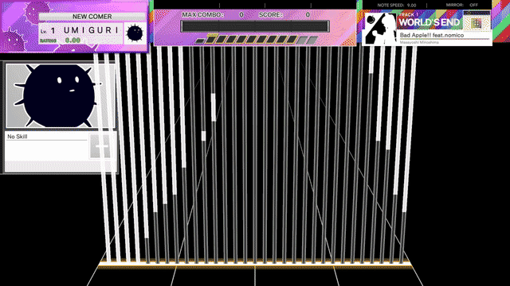

# umiguri-aircrush-badapple

用 **AirCrush 装饰线**在 [UMIGURI](https://umgr.inonote.jp/) 里播放 **Bad Apple!!**：把视频逐帧转换成 Margrete 谱面里的 AirCrush 线条，再用多条时间轴（TIL）的变速事件，让画面按固定帧率在判定线上逐帧切换。

*Play the Bad Apple!! video inside UMIGURI (a CHUNITHM-style simulator) using only AirCrush decoration lines and timeline speed events, generated into a Margrete chart via [margrete-rpc](https://github.com/Foahh/margrete-rpc).*



实机录屏（无声）：[media/demo.mp4](media/demo.mp4)

## 效果

| 项目 | 数值 |
|---|---|
| 画面 | 31 列 × 25 行，黑白两档 |
| 帧率 | 15 fps，全曲 3485 帧（232 s） |
| 谱面内容 | 7638 个 AirCrush，约 76 万个控制点，21097 个速度事件 |
| 约束 | 所有节点都在 384 分割（5 tick）上；只用 TIL 0~63；视频只占 TIL 1~63，TIL 0 可以放正常谱面 |

## 原理（简述）

1. **画面**：视频缩成 31×25。每列同色的连续格子画成一条竖线，每条画两遍（更不透明）。画面上沿正好对齐判定线上的屏幕上沿（h=240）。
2. **藏线**：整幅画面放在 0x 段里。实测 0x 里竖线看得见、纯横线看不见，h>240 在屏幕外。于是同一条 TIL 上全部画面的同色笔画用**欧拉回路**串成一个 AirCrush：换列走横线，换画面从屏幕上方绕过去。被另一种颜色包围的色块单独一个 AirCrush。
3. **播放**：TIL 1~63 轮流负责。平时停在 500 万远处；轮到时 5 tick 内跳到对应画面的卷动量并用 0x 定住，下一帧再飞回远处。画面全部存放在视频结束 12 秒之后，那时游戏画面已经结束。
4. **结尾**：最后一帧放一个 Damage 音符，否则 UMIGURI 会提前结束画面。

一共迭代了 14 版。实测规律、每一版为什么失败、性能结论（UMIGURI 的开销先由 AirCrush 个数决定、再由控制点数决定）都写在 [docs/NOTES.md](docs/NOTES.md)。

## 使用方法

### 准备

- Windows，[Margrete](https://umgr.inonote.jp/) v1.8.0 + UMIGURI
- [margrete-rpc](https://github.com/Foahh/margrete-rpc) 插件（放进 Margrete 的 `plugins` 目录）
- Python 3.10+，[ffmpeg](https://ffmpeg.org/)（在 PATH 里）
- Bad Apple!! PV 视频文件（本仓库**不提供**），以及对应音频做成的 BPM 138 空白谱面

```
pip install -r requirements.txt
```

### 步骤

1. 在 Margrete 里打开一张**空白**谱面：BPM 138，4/4，offset 0，放好音乐。
2. 菜单「扩展功能 → 管理扩展」勾选 `margrete_rpc.dll`（只需一次），再点「扩展功能 → Margrete RPC」启动服务端，记下显示的 4 位实例 ID。
3. 先预览前 5 秒（不写入，生成 `badapple_preview.png` 缩略图并校验）：
   ```
   python badapple_air.py --video badapple.mp4
   ```
4. 写入整首（把 `1234` 换成你的实例 ID）：
   ```
   python badapple_air.py --video badapple.mp4 --seconds 232.396 --write --instance 1234
   ```
5. 在 Margrete 里**手动保存**，然后用 UMIGURI 预览。

注意：
- 一定要写到空白谱面上。在已有完整版的谱面上重写，Margrete 删速度事件会非常慢。
- 完整版超过 RPC 单条消息 16 MB 的上限，写入后读不回来；正确性靠写入前的校验（`python tools/check_link.py 232.396 top 25 240 top 15`）。
- 用别的视频：改 `--video`，并按需要调整 `--audio-lag`（谱面音频比视频晚多少秒）、`--threshold`（二值化阈值）。黑白分明的动画效果最好。别的 BPM 需要改 `badapple_air.py` 里的 `BPM` 常量。

常用参数见 `python badapple_air.py -h` 和 [docs/NOTES.md](docs/NOTES.md#9-工具清单)。

## 文件

| 文件 | 作用 |
|---|---|
| `badapple_air.py` | 主生成器 |
| `zero_link.py` | 同 TIL 同色画面串链 |
| `euler_paths.py` | 按列取色块、欧拉路径 |
| `aircrush_kit.py` | 通用 AirCrush 折线工具（384 分割吸附、宽度/中点换算、切链） |
| `tools/` | 校验脚本，以及在 UMIGURI 里实测各种规律用的诊断脚本 |
| `docs/NOTES.md` | 完整技术笔记 |

## 致谢 / 版权

- [margrete-rpc](https://github.com/Foahh/margrete-rpc)（Foahh）：Margrete 的 RPC 插件与 Python 客户端。
- Margrete / UMIGURI 由 inonote 开发。
- Bad Apple!! 原曲出自东方 Project（ZUN），PV 由あにら制作。本仓库不包含视频、音频或生成的谱面；演示录屏仅作效果展示。

本仓库代码以 [MIT License](LICENSE) 发布。
